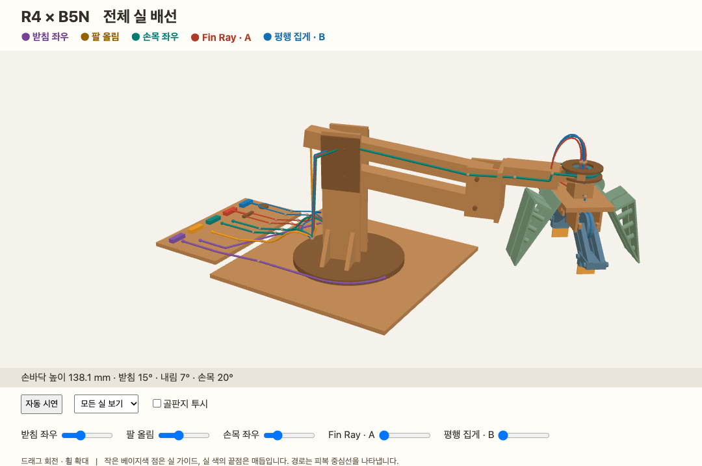

# R4 × B5N 실 구동 로봇 팔



[전체 동작 시연 · 17초 MP4](R4-B5N-자동시연.mp4) · [오프라인 3D 뷰어](R4-B5N.html)

HTML을 내려받아 WebGL 브라우저에서 연다. 아래 다섯 조작 바로 받침, 팔 높이, 손목, Fin Ray, 평행 집게를 움직인다. 한 가닥씩 따라보려면 경로 선택 메뉴와 골판지 투시를 함께 사용한다.

| 제작 자료 | 용도 |
|---|---|
| [팔 제작 시트](01-팔-제작시트.md) | 빨대 가이드, 고정 매듭, 축, 조작판 조립 |
| [실물 재단도](02-A3-재단도.pdf) | A3 가로 7쪽 각 1부, 100% 배율, 시험편 포함 93개 |
| [조립 애니메이션](03-조립시연.mp4) | 받침부터 손목 배선까지 28초 |
| [B5N 장착 인계서](04-B5N-장착-인계서.md) | 장착면과 A/B 출구, 조립 후 인수 시험 |

그리퍼 형상과 관절 운동은 [공용 모델](../../src/core/designs.ts)의 `makeB5('B5N')`에서 읽는다. 팔 버전에서는 손목 중앙을 통해 실을 조작판으로 보내고, Fin Ray 초기 열림을 30°로 제한한다. 시연은 기구 운동과 실의 경로를 보여준다. 허용 하중, 실의 마찰, 손목 회전에 따른 의도치 않은 파지, 골판지 처짐은 실물에서 측정할 항목이다.

## 다시 만들기

저장소 최상위에서 Node.js 22 이상으로 실행한다.

```sh
npm ci
node arm/R4-B5N/build.mjs
```

재단도를 갱신할 때는 Python 3 환경에 ReportLab을 설치하고, 한글 글리프가 있는 TrueType 글꼴의 실제 경로를 지정한다. 두 생성물은 이 폴더에 저장된다.

```sh
python3 -m pip install reportlab
python3 arm/R4-B5N/cut-sheet.py --font "/path/to/Korean-font.ttf"
```
