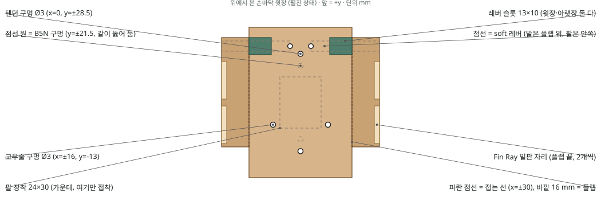
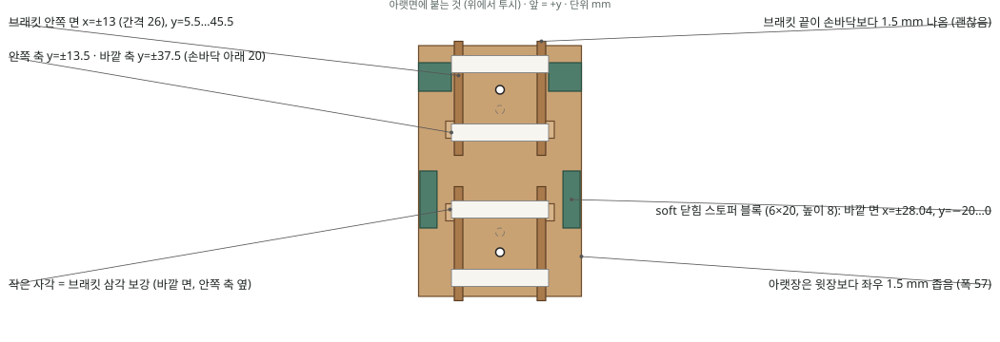
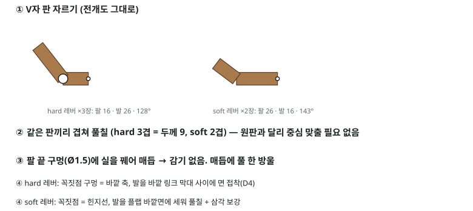
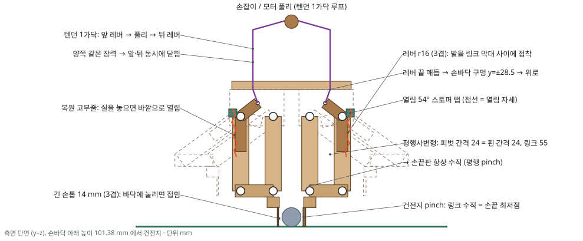
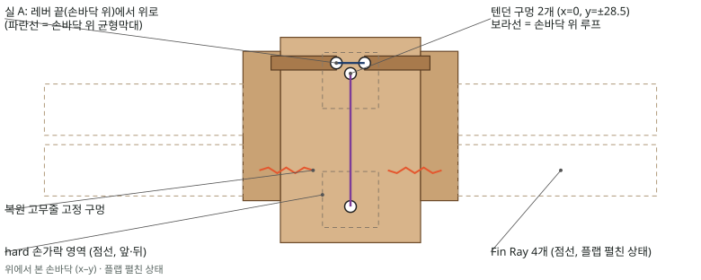

# B5E 그리퍼 제작 설명서 (영상 과제용 · 쉬운 버전)

전개도 `patterns/B5E/B5E-전개도-A4.pdf` 기준이에요. 아래에서 **#번호**는 도면에 적힌 부품 번호(1–3쪽 #1–#22, 4–5쪽 여분 #23–#34)예요.
치수는 mm이고, `params/B5E.json`과 `calc/out/B5E.json`(SymPy 검증)에서 가져왔어요.

## 0. 먼저 알아 둘 것

- **방향:** 손바닥 윗장에서 **레버 슬롯(사각 구멍 2개)이 있는 쪽이 앞(+y)** 이에요. 앞쪽 hard 손가락이 이쪽, 뒤쪽 손가락은 반대쪽이에요.
- **x / y:** soft(Fin Ray) 플랩은 좌·우(x), hard 손가락은 앞·뒤(y)에 달려요.
- **수량:** 두 가지 PDF가 있어요.
  - `B5E-전개도-전량-A4.pdf` (**추천**, 9장): 부품이 **수량만큼 모두** 그려져 있어요. 인쇄 → 붙이기 → 자르기만 하면 돼요. 라벨 `#6 바깥 링크 막대 (3/8)` = 부품 #6, 8개 중 3번째.
  - `B5E-전개도-A4.pdf` (5장): 부품이 **한 번씩만** 그려져 있고 `×수량`이 적혀 있어요. 처음 자른 것을 본으로 대고 따라 그려요.
- **"N장 적층":** 같은 판 N장을 겹쳐 풀칠해 부품 1개를 만든다는 뜻이에요. 예: 손끝판 ×6 = 3장 적층 × 손가락 2개.
- **표기 정정:** 인쇄본에 **#4 링크 브래킷, #11 커플러 측판**이 "2겹"으로 적혀 있는데 **1겹이 맞아요**(수량 4장 그대로). 빨대 핀 길이 32 mm가 1겹 기준이에요.
- **선 종류:**

| 표시 | 뜻 | 도구 |
|---|---|---|
| 검정 실선 | 자르기 | 커터칼 + 쇠자, 2–3번 나눠 긋기 |
| 파란 점선 | 접는 선 (자르지 않음) | 다 쓴 볼펜으로 자 대고 꾹 |
| 빨간 원 + 십자 | 구멍 | 송곳으로 중심 → 시험편으로 고른 지름까지 넓히기 |
| 주황 빗금 | 풀칠 자리 | 목공풀 얇게 |
| 회색 일점쇄선 | 다른 부품 붙일 위치 | 연필로 옮겨 그리기 |
| 초록 화살표 | 골판지 골 방향 | 이 방향에 골을 맞춰 자르기 |

- **구멍 지름:**
  - 빨간 원 중 **Ø6.5로 그려진 것은 전부 빨대 구멍**이에요. 실제 지름은 1단계 시험편으로 정해요.
  - **Ø3** 실·고무줄 구멍(송곳으로 뚫고 볼펜심으로 넓히기).
  - **Ø1.5** 매듭 구멍(송곳 끝만).

## 1. 구멍 맞춤 시험편 (#3) — 가장 먼저

1. #3을 2장 잘라요. 한 장은 그대로(1겹), 한 장은 2장 겹쳐 붙인 판에서 잘라요(2겹 부품용).
2. 구멍 4개(Ø6 / 6.3 / 6.6 / 7)를 뚫어요.
3. 실제 빨대를 꽂아서 **"덜컥거리지 않고 손가락으로 부드럽게 도는"** 구멍을 골라요 → 이 지름 = **회전 구멍**.
4. 빨대가 **꽉 끼는** 구멍도 하나 기억해 둬요 → **고정 구멍**(브래킷처럼 빨대가 안 돌아야 하는 곳. 안 되면 풀로 고정).
5. 골판지 두께와 빨대 바깥지름을 자로 재서 기록해요.

## 2. 손바닥 (#1 윗장 + Soft 플랩, #2 아랫장)

1. **#1 윗장**(92×88): 가운데 60×88이 손바닥이고, 좌·우 16 mm 폭이 플랩이에요. 파란 점선(접는 선)은 **x=±30 위치 2줄**이에요.
2. **#2 아랫장**(57×88): 윗장 손바닥보다 **좌우 1.5 mm씩 좁아요**. 플랩이 −8°까지 안쪽으로 닫힐 공간이에요(SymPy S5).
3. 두 장을 **골 방향이 엇갈리게**(윗장 ↔, 아랫장 ↕) 겹쳐 풀칠해요.
   - 아랫장은 **접는 선 안쪽 1.5 mm에서 끝나도록** 가운데 맞춰요.
   - 앞(+y) 끝은 양쪽을 일치시켜요.
   - **플랩 부분엔 풀이 묻으면 안 돼요.**
4. 마른 뒤 **두 장을 함께** 뚫어요.

| 구멍 | 위치 (손바닥 가운데 기준) | 지름 | 용도 |
|---|---|---|---|
| 텐던 구멍 2 | x=0, y=±28.5 | Ø3 | hard 실 루프 (B5E) |
| 'B5N' 구멍 2 | x=0, y=±21.5 | Ø3 | 나중에 드럼으로 바꿀 때 (같이 뚫어 둠) |
| 고무줄 구멍 2 | x=±16, y=−13 (뒤쪽) | Ø3 | soft 복원 고무줄 |
| 레버 슬롯 2 | 접는 선에서 안쪽 13 mm, y=+28…+38 (앞쪽), 폭 10 | 사각 | soft 레버가 지나가는 통로 — 윗장·아랫장 **둘 다** 잘라냄 |

5. 플랩을 접는 선에서 아래로 한 번 접었다 펴서 길을 들여요.

## 3. 아랫면 부착물: 닫힘 스토퍼 블록 (#14)

1. #14(20×8)를 **2장씩 겹쳐 블록 2개**를 만들어요(두께 6, 높이 8).
2. 손바닥 **아랫면 뒤쪽 절반**(y=−20…0, 즉 가운데에서 뒤로 20 mm)에, 블록 바깥 면이 아랫장 옆 가장자리와 거의 같은 선(x=±28.0)에 오게 세워 붙여요.
3. 플랩이 닫힐 때 플랩 안쪽 면이 이 블록 아래 모서리에 −8°에서 기대요.

## 4. Fin Ray 4개 (#15, #16, #21, #22 + #9 밑판)

1. **띠 만들기:** 띠 4개(214.5×22)를 잘라 한쪽 겉종이(라이너)를 물티슈로 적셔 벗기고 말려요. 드라이어로 5분이면 돼요.
   - 골이 폭 방향이라 길이 방향으로 잘 휘어요.
   - 골이 드러난 면이 **삼각형 안쪽**으로 가게 접어요.
2. 띠 구간(한쪽 끝부터): **contact 85 → back 89.5 → 밑변 28 → 풀칠 탭 12**. 접는 선 3개(85, 174.5, 202.5)를 접어 삼각형을 만들고, 탭을 contact 뿌리(띠 시작 끝) 안쪽에 풀칠해요.
3. **빨대 리브 4개를** 같은 번호끼리(R2–R8) contact 쪽과 back 쪽 사이에 수평으로 넣고 양 끝을 **투명테이프로 감싸 힌지**로 붙여요.

| 리브 | contact 뿌리에서 | 도면 길이 | 자를 길이 (벽 두께 빼고) |
|---|---|---|---|
| R2 | 17 | 22.4 | 약 20 |
| R4 | 34 | 16.8 | 약 15 |
| R6 | 51 | 11.2 | 약 9 |
| R8 | 68 | 5.6 | 약 4 (어려우면 생략) |

   - 접은 삼각형에 대 보고 다듬는 게 가장 정확해요.
   - **풀·글루건 금지:** 리브 양끝이 돌아야 Fin Ray가 물체를 감싸요.
4. **밑판 #9**(36×22): 접는 선(8 mm)을 접어 ㄱ자로 만들어요.
   - 8 mm 탭(빗금)을 **플랩 끝부분 바깥면**에 풀칠해요.
   - 28 mm 부분이 플랩에서 바깥으로 직각으로 튀어나오고, 그 아래에 Fin Ray 밑변을 붙여요.
   - **contact 면(85 mm 쪽)은 플랩과 한 줄로, 물체 쪽(안쪽)** 을 향하게 해요.
5. 플랩 하나에 Fin Ray 2개: **y=+2…+24, y=−24…−2**, 가운데 4 mm 틈이에요(윗장 지도의 Fin Ray 자리).
6. 확인: Fin Ray 끝을 손가락으로 누르면 **누른 쪽으로 감기듯** 휘어야 해요.

## 5. soft 레버 (#10 ×4 = 2장 적층 × 2개, #18 삼각 보강 ×4)

1. #10을 2장씩 겹쳐 레버 2개를 만들어요. V자: **팔 26 / 발 16 / 사이각 143°**, 팔 끝에 Ø1.5 매듭 구멍이 있어요.
2. 레버를 **꼭짓점이 접는 선(힌지) 위, y=+33**(레버 슬롯 가운데)에 오게 세워요.
   - **발(16)** 을 플랩 바깥면(윗장의 윗면이었던 면)에 세워서 풀칠해요. 발이 플랩 폭 16을 따라 끝까지 가요.
   - **팔(26)** 은 손바닥 위로 안쪽을 향해요. 꼭짓점 근처는 레버 슬롯 안으로 들어가요.
3. 발 양쪽에 #18 삼각 보강을 붙여요(레버가 플랩에서 꺾이지 않게).
4. 확인: 플랩을 열어 보면 약 **35°에서 레버 팔이 손바닥 윗면(슬롯 끝)에 닿아 멈춰요** → 이게 열림 스토퍼라서 별도 블록이 필요 없어요(SymPy E11). 영상용 열림은 30°예요.

## 6. hard 손가락 2개 (앞·뒤, 하나씩 완성)

손가락 1개에 쓰는 부품:

| 부품 | 1개 손가락 분 | 메모 |
|---|---|---|
| #4 링크 브래킷 | 2장 (1겹) | 좌·우 |
| #19 브래킷 삼각 보강 | 2 | |
| #20 열림 스토퍼 탭 | 4장 → 탭 2개 | 2장 적층 |
| #6 바깥 링크 막대 | 4장 → 막대 2개 | 2장 적층 |
| #7 안쪽 링크 막대 | 4장 → 막대 2개 | 2장 적층 |
| #5 hard 레버 | 3장 → 1개 | 3장 적층 (두께 9) |
| #11 커플러 측판 (L자) | 2장 (1겹) | 좌·우 |
| #17 손끝판 | 3장 → 1개 | 3장 적층 |
| #12 손톱 플랩 | 3장 → 1개 | 3장 적층 |
| #13 손톱 스토퍼 | 1 | |
| 빨대 | 32 mm × 4 | 안쪽 축 · 바깥 축 · 아래 핀 2 |

### 6-1. 링크 막대와 레버
1. #6, #7을 2장씩 겹쳐 막대 4개(바깥 2, 안쪽 2)를 만들어요.
2. **막대 4개를 한꺼번에 겹쳐 놓고 양끝 구멍을 같이 뚫어요.** 구멍 간격 **55**가 네 막대 모두 같아야 평행사변형이 돼요(평행도는 ±1 mm가 생명).
3. #5 hard 레버 3장을 겹쳐 붙여요. V자: **팔 16 / 발 26 / 사이각 128°**, 꼭짓점 구멍 = 축 구멍, 팔 끝 Ø1.5 = 매듭 구멍.
4. **바깥 막대 2개 사이에 레버를 끼워 면 풀칠**해요(샌드위치).
   - 레버 꼭짓점 구멍 = 막대의 **위쪽 구멍**에 맞춰요. 빨대를 꽂아서 정렬하고, 빨대엔 풀이 안 묻게 해요.
   - **발(26)** 은 막대를 따라 아래쪽(손끝 방향)으로 놓아요.
   - **팔(16)** 은 손바닥 가운데 쪽(안쪽 축 쪽)을 향해요.
   - 토크는 골판지 접착면으로 전달되고, **빨대는 핀 역할만** 해요.

### 6-2. 브래킷과 축
1. #4 브래킷(40×38): 위 **8 mm 탭**(빗금)을 접는 선에서 **바깥쪽으로** 90° 접어요. 구멍 2개(간격 24)에 **"안쪽 축"·"바깥 축"** 이 적혀 있어요.
2. 빨대를 끼워요.
   - **바깥 축(32):** 브래킷 – 바깥 막대 – 레버 – 바깥 막대 – 브래킷
   - **안쪽 축(32):** 브래킷 – 안쪽 막대 – (빈 틈) – 안쪽 막대 – 브래킷
3. 축을 끼운 채로 **브래킷 탭을 손바닥 아랫면에 풀칠**해요(아랫면 지도 참고).
   - 브래킷 **안쪽 면 x=±13** (두 브래킷 안쪽 면 간격 26)
   - y = 5.5…45.5 (앞 손가락). 안쪽 축 y=13.5, 바깥 축 y=37.5. 바깥 끝이 손바닥보다 1.5 mm 나오는데 괜찮아요.
   - 뒤 손가락은 y를 뒤집어 같은 자리에 붙여요.
   - 축은 손바닥 아랫면에서 **20 mm 아래**에 와요.
4. 브래킷 바깥 면 안쪽 축 옆에 #19 삼각 보강을 붙여요(브래킷 ↔ 손바닥).
5. **열림 스토퍼 탭:** #20 2장 겹쳐 탭 2개를 만들어요. 브래킷 안쪽 면의 **"스토퍼 탭" 표시(바깥 축 옆)** 에 붙이면 막대 평면까지 튀어나와요. 손가락이 54°까지 열리면 바깥 막대 윗면이 여기에 기대요.
6. 막대와 브래킷 사이에 2.5 mm 틈이 있어요. 막대가 옆으로 밀리면 빨대에 테이프를 한 바퀴 감아 칼라를 만들어요.

### 6-3. 커플러 · 손끝판 · 손톱
1. #11 커플러 측판(L자) 2장의 위쪽 구멍 2개(간격 24)를 막대 아래쪽 구멍에 맞춰요.
   - **안쪽 핀(32):** 측판 – 안쪽 막대 – 안쪽 막대 – 측판
   - **바깥 핀(32):** 측판 – 바깥 막대 – 바깥 막대 – 측판
   - L자의 **세로 다리가 안쪽 핀 아래**로 오게 해요(물체 쪽).
2. #17 손끝판 3장을 겹쳐서 **두 측판 세로 다리 사이**에 풀칠해요(폭 24).
3. 손으로 막대를 돌려 보며 **손끝판이 계속 수직인지** 확인해요. 기울면 막대 구멍 간격부터 의심해요.
4. 손톱 #12(22×20, 위 6 mm에 접는 선) 3장:
   - **1장만** 6 mm 탭을 남기고, 나머지 2장은 탭을 잘라내 아래 14 mm만 겹쳐 붙여요(접히는 곳이 9 mm로 두꺼워지지 않게).
   - 탭을 손끝판 **바깥면** 아래쪽에 붙이고, 접는 선을 손끝판 아래 모서리에 맞춰 투명테이프로 앞뒤를 감싸요.
   - 손톱이 아래로 14 mm 나와요.
5. #13 손톱 스토퍼(22×8)를 손끝판 **안쪽 면(물체 쪽) 아래**에 붙여요. 손끝판 아래 모서리보다 2 mm 아래로 튀어나오게 해서 손톱이 안쪽으로 못 접히게 막아요.
   - 결과: 쥐는 방향은 단단하고, 바닥에 눌리면 **바깥·위로 접혀요**(최대 약 11.6 mm 순응).
6. 손톱 안쪽 면에 고무줄을 2바퀴 감아 미끄럼을 막아요.
7. **레버 확인:** 손가락을 끝까지 닫았다 열었다 하면서 **레버 팔 끝이 안쪽 축 빨대에 닿지 않는지** 봐요. 계산상 여유가 **약 1 mm**라 가장 빠듯한 곳이에요(SymPy E5). 닿으면 팔 끝을 1–2 mm 다듬거나 여분 #25로 바꿔요.

## 7. 실과 고무줄

| 줄 | 경로 | 길이 (단독 시험 / R5-F1 팔) |
|---|---|---|
| **텐던 루프 (hard, 1가닥)** | 앞 hard 레버 끝 Ø1.5 매듭 → 손바닥 구멍 y=+28.5 위로 → 손잡이 → 구멍 y=−28.5 아래로 → 뒤 hard 레버 끝 매듭 | 약 0.6 m / 2.4 m |
| **실 A 좌·우 (soft)** | soft 레버 끝 매듭 → 위로(x≈±29) → 균형막대 #8 양끝 → 가운데 구멍 → 직렬 고무줄 → 손잡이 | 각 약 0.4 m / 각 1.2 m |
| **soft 복원 고무줄 ×2** | 손바닥 고무줄 구멍(x=±16, y=−13) 아래에 매듭 → 위로 나와 → 플랩 바깥면(힌지에서 약 11 mm)에 테이프 | — |
| **hard 복원 고무줄 ×2** | 바깥 막대 아래 끝 ↔ 브래킷 바깥 위 모서리, 테이프 고정 | — |

- **감기 없이 매듭만** 해요. 매듭에 풀을 한 방울 떨어뜨려 풀림을 막아요.
- **실 길이는 마스킹테이프로 임시 고정**한 뒤 전 범위 동작을 확인하고 매듭지어요.
- **#8 균형막대:** 2장 겹쳐 1개예요. 구멍 3개(양끝, 가운데). R5-F1 팔에 달 때는 균형막대와 B 움직도르래가 **팔 조작판**에 있으니, 그리퍼 쪽은 실 꼬리만 길게 남겨요.
- **힘 (영상용):**
  - hard 쥐는 힘 **1–2 N** (건전지 최소 0.85 N), soft는 손가락당 **0.5 N 이하**
  - 이때 실 장력은 텐던 약 6 N, 실 A 약 5 N이에요(SymPy E4, E9).
  - **복원 고무줄은 이보다 확실히 약하게** 해요. 실을 놓으면 열릴 정도면 충분해요.

## 8. 완성 점검

- [ ] 실 B(텐던)를 당기면 앞·뒤 손가락이 **동시에** 닫히고, 손끝판이 **수직**을 유지해요.
- [ ] 놓으면 손가락이 54°까지 열려 스토퍼 탭에 기대요.
- [ ] 실 A를 당기면 좌·우 플랩이 닫히고 Fin Ray가 감싸요. 놓으면 약 30–35°까지 열려요.
- [ ] 손톱이 바닥에 눌리면 바깥·위로 접히고, 떼면 돌아와요.
- [ ] hard 레버 끝이 안쪽 축에 안 닿아요.
- [ ] 건전지(가로로 놓인 AA)를 쥐고 들어 올려도 미끄러지지 않아요.
- [ ] 팔에 달 때는 **손바닥 윗면 가운데 24×30 안에만** 접착해요(윗장 지도의 점선 사각).

## 부록: B5N(드럼)으로 바꿀 때 (4–5쪽 #26–#34)

- 손바닥은 그대로예요. 'B5N' 구멍(y=±21.5)을 쓰고, soft는 드럼이면 90°까지 열려요.
- **hard:** 드럼 큰판 #26 2장 + 작은판 #28 1장(큰-작은-큰)을 빨대 지그로 중심 맞춰 붙여요 → 실 홈 3 mm. **새 바깥 막대 #34** 2개 사이에 면 접착해요. 실은 드럼 홈에 1바퀴 감고 'B5N' 구멍으로 올려요.
- **soft:** 드럼 큰판 #29 2장 + 작은판 #31 1장 → 플랩 바깥면 힌지선에 세워 붙이고 삼각 보강을 해요. 실은 홈에 매듭 → 1/2바퀴 → 안쪽 접선에서 위로 올려요.
