# B6P 그리퍼 제작 설명서 (영상 과제용 · 쉬운 버전)

전개도는 `patterns/B6P/B6P-전개도-전량-A4.pdf`(A4 4장, **수량만큼 모두 그려져 있음**)를 써요. 아래 **#번호**는 도면에 적힌 부품 번호예요.
치수는 mm이고, `params/B6P.json`과 `calc/out/B6P.json`(SymPy 검증)에서 가져왔어요.

## 한눈에 보기

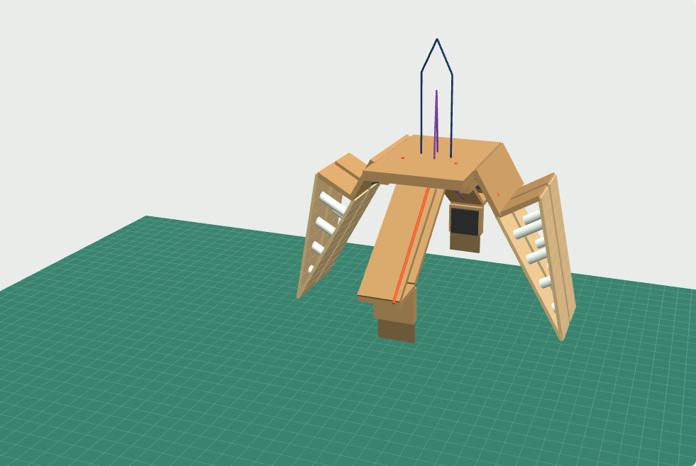

### 그리퍼는 세 덩어리예요

```
          (실 2가닥 → 위 손잡이)
     ┌──────────────────────┐
 날개│       손바닥 판       │날개   ← 좌·우: 부드러운 손가락 (Fin Ray)
     └──────────────────────┘
          │            │
       접는 상자      접는 상자       ← 앞·뒤: 딱딱한 손가락 (끝이 항상 수직)
```

1. **손바닥 판**: 골판지 두 장을 겹친 판. 양쪽 끝(30 mm)이 접혀서 날개가 돼요.
2. **좌·우 날개 (soft)**: 날개 끝에 삼각형 **Fin Ray** 2개씩. 감자칩·스펀지처럼 부드러운 걸 감싸요.
3. **앞·뒤 손가락 (hard)**: 띠 한 장을 접은 **납작한 상자**. 옆으로 기울면 평행사변형이 돼서 **손끝판이 항상 수직**으로 내려와요. 건전지·뚜껑을 집어요.

**움직이는 원리:** 실을 당기면 닫히고, 놓으면 고무줄이 다시 벌려요.

- **날개 실 한 가닥**이 좌·우 날개를 같이 당겨요.
- **손가락 실 한 가닥**이 앞·뒤 손가락을 같이 당겨요.
- 실은 판의 **매듭 구멍**에 묶고, 손바닥 밑에서 **X자로 교차**해 **반대쪽 구멍**으로 올라가요. 레버·드럼·빨대 핀이 없어요.

**왜 교차시키나:** 실이 반대쪽 구멍으로 가면 지렛대(모멘트 팔)가 길어져서 **필요한 힘이 줄고, 당기는 거리는 늘어요.** 멀리서(팔을 거쳐) 당기기 쉬워져요.

| | 교차 전 | **교차 후** |
|---|---|---|
| 손가락 하나에 필요한 실 장력 (hard / soft) | 9.9 / 9.5 N | **6.1 / 6.5 N** |
| 손잡이 힘 (두 가닥, 구멍 빨대 포함, 팔 마찰 제외) | 약 20 N | **약 13 / 17 N** |
| 당기는 거리 (hard / soft) | 9 / 8 mm | **15 / 14 mm** |

### 꼭 지킬 3가지

1. **접는 상자 띠의 두 링크(75 mm) 길이를 똑같이** 자르기 — 평행은 이것으로만 결정돼요
2. **날개 접히는 곳에 풀 금지**
3. **Fin Ray 빨대 끝은 테이프** (풀 금지) — 돌아야 휘어요

## 0. 준비


- **인쇄:** A4, **실제 크기 100%**, "페이지에 맞춤" 끄기. 각 장의 **100 mm 눈금**을 자로 재서 확인해요.
- **선 종류:**

| 표시 | 뜻 | 도구 |
|---|---|---|
| 검정 실선 | 자르기 | 커터칼 + 쇠자, 2–3번 나눠 긋기 |
| 파란 점선 | 접는 선 (자르지 않음) | 다 쓴 볼펜으로 자 대고 꾹 |
| 빨간 원 | 구멍 (큰 원 Ø6.5 = 빨대 슬리브, 작은 원 Ø3 = 매듭·고무줄) | 송곳으로 뚫고 연필로 넓히기 |
| 주황 빗금 | 풀칠 자리 | 목공풀 얇게 |
| 초록 화살표 | 골판지 골 방향 | 이 방향에 골을 맞춰 자르기 |

- **"N장 적층"** = 같은 판 N장을 겹쳐 풀로 붙여 부품 1개. B6P에선 손끝판(2장)·손톱(3장)·스토퍼 블록(2장)뿐이에요.
- **준비물:** 3 mm 골판지(택배상자 1–2개), 빨대 5개(Fin Ray 리브 + 슬리브), **매끄러운 실**(낚싯줄·연줄) 약 2 m, 얇은 고무줄 6개, 목공풀, 투명테이프, 커터칼, 쇠자, 송곳, 다 쓴 볼펜.

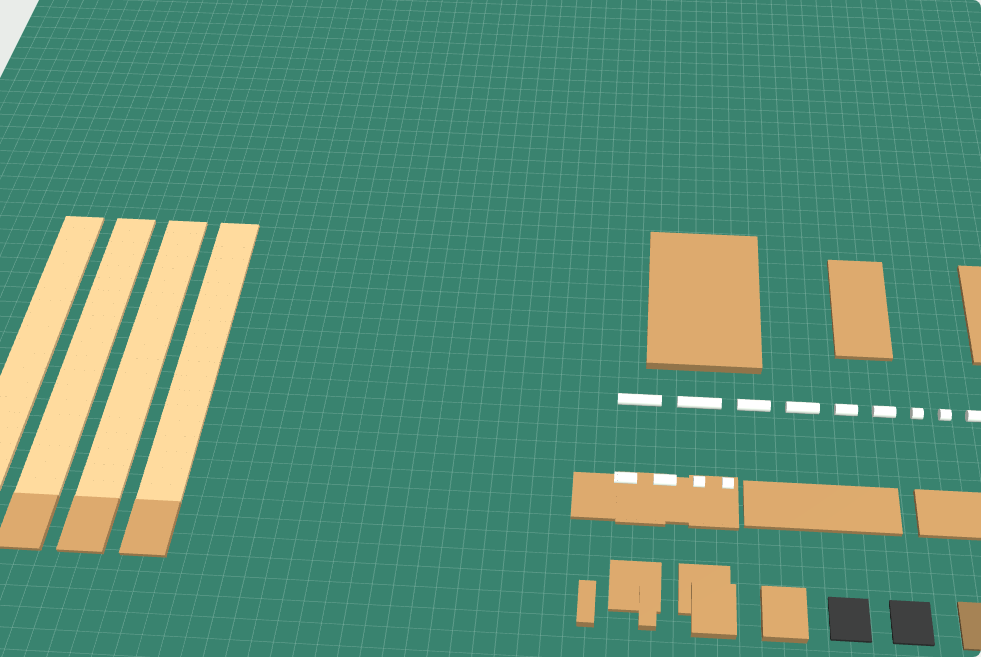

## 1단계: 손바닥 (#1 윗장, #3 아랫장, #7 스토퍼 블록)


1. **#1 윗장**(120×88)은 가운데 60×88이 손바닥, 좌·우 **30 mm 폭이 날개**예요. 파란 점선 2줄(x=±30)이 접는 선이에요.
2. **#3 아랫장**(57×88)은 윗장 손바닥보다 좌우 1.5 mm씩 좁아요. 날개가 −8°까지 안쪽으로 닫힐 공간이에요.
3. 두 장을 **골 방향이 엇갈리게**(윗장 ↔, 아랫장 ↕) 가운데 맞춰 풀칠해요. **날개 부분엔 풀 금지.**
4. 마른 뒤 구멍을 뚫어요.

| 구멍 | 위치 (손바닥 가운데 기준) | 지름 | 용도 |
|---|---|---|---|
| **실 구멍 4개** | soft: (−10, +1.5), (+10, −1.5) · hard: (+1.5, −8), (−1.5, +8) | **Ø6.5** | 실이 위로 올라가는 곳 — **빨대 슬리브**를 끼워요. 윗장·아랫장 **둘 다** |
| 날개 매듭 2개 | 접는 선에서 바깥 26 mm, y=0 | Ø3 | soft 실 매듭. 구멍 주변을 **테이프로 보강** |
| 고무줄 2개 | x=±16, y=−13 (뒤쪽) | Ø3 | soft 복원 고무줄 |

5. **빨대 슬리브 4개:** 빨대를 **10 mm**씩 잘라 실 구멍에 끼우고 풀로 고정해요.
   - 실이 손바닥 밑에서 들어오는 쪽으로 **살짝 기울여** 꽂아요.
   - 자른 끝은 손톱으로 살짝 벌리거나 다듬어서 **둥글게** 해요. 날카로우면 실이 걸려요.
   - 골판지 구멍(마찰 약 2배)보다 빨대(약 1.3–1.5배)가 실이 훨씬 잘 미끄러져요.

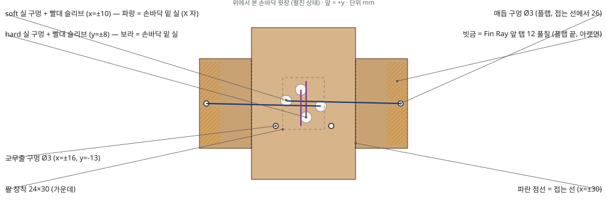

6. **#7 스토퍼 블록**: 2장씩 겹쳐 블록 2개(6×20, 높이 8). 아랫면 표시 자리(뒤쪽, y=−24…−4)에 바깥 면이 가장자리와 거의 같은 선이 되게 세워 붙여요. 날개가 너무 안쪽으로 닫히지 않게 막아요.


## 2단계: Fin Ray 4개 (#9–#12)


1. 띠 4개(226×22)의 **한쪽 겉종이를 물티슈로 적셔 벗겨요**. 드라이어로 말리면 5분이에요. 골이 드러난 면이 삼각형 **안쪽**으로 가게 접어요.
2. 띠 구간 (한쪽 끝부터): **앞 탭 12 → contact 85 → back 89.5 → 밑변 28 → 끝 탭 12**
   - 접는 선 4개를 접어 삼각형을 만들고, **끝 탭**을 contact 뿌리 안쪽에 풀칠해요.
3. **빨대 리브 4개**를 같은 번호끼리(R2–R8) 수평으로 끼우고 양 끝을 **투명테이프로 감아** 힌지처럼 붙여요.

| 리브 | 도면 길이 | 자를 길이 (벽 두께만큼 짧게) |
|---|---|---|
| R2 (넓은 쪽) | 22.4 | 약 20 |
| R4 | 16.8 | 약 15 |
| R6 | 11.2 | 약 9 |
| R8 (끝 쪽) | 5.6 | 약 4 (어려우면 생략) |

4. **앞 탭(12)** 을 날개 **끝부분 안쪽 면**(윗장의 아랫면 쪽, 빗금 자리)에 풀칠해요.
   - contact 면이 날개와 한 줄로 이어져요.
   - 날개 하나에 Fin Ray 2개가 붙고, 가운데 4 mm 틈에 매듭 구멍이 있어요.

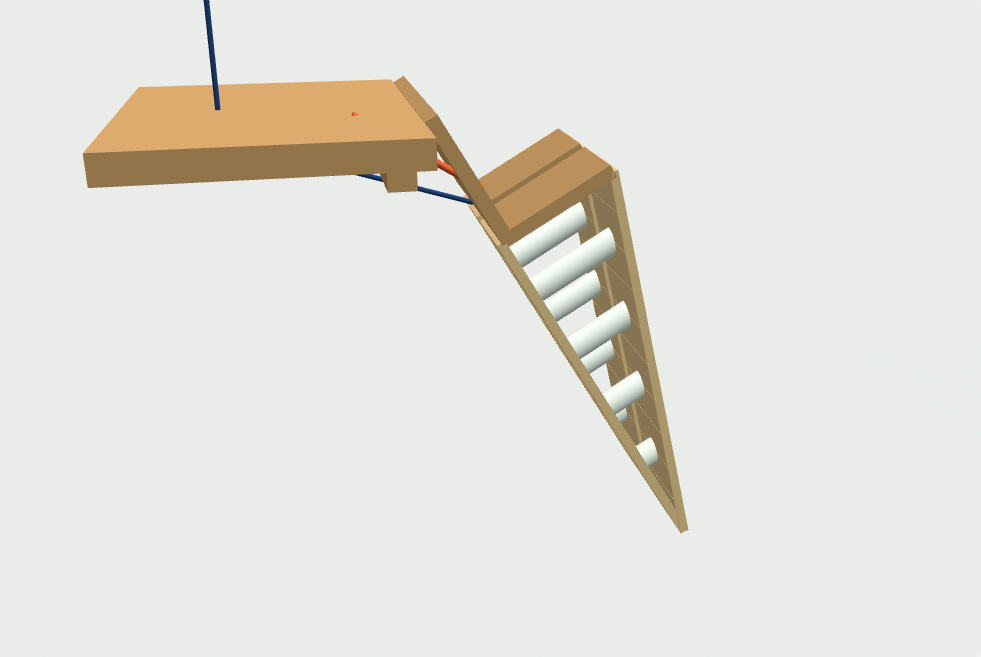

5. 시험: Fin Ray 끝을 손가락으로 누르면 **누른 쪽으로 감기듯** 휘어야 해요.

## 3단계: 접는 상자 손가락 2개 (#2, #4, #5, #6, #8)

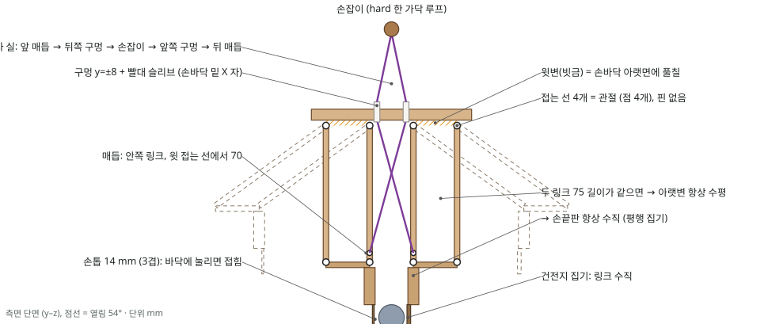

### 3-1. 띠를 접어 상자 만들기


1. **#2 띠**(210×24) 구간: **윗변 24 → 바깥 링크 75 → 아랫변 24 → 안쪽 링크 75 → 탭 12**
2. 파란 접는 선 **4개를 깊게 눌러요.** 이 관절들은 양쪽으로 굽어야 하니 **앞뒤로 여러 번 꺾어 길들여요.**
3. 접는 선 4개의 **바깥 면에 투명테이프**를 붙여요. 골판지가 찢어지지 않게 보강하는 거예요.


4. 띠를 고리처럼 접어서 **끝 탭을 윗변 안쪽 끝에 겹쳐 풀칠**해요. 이게 납작한 상자예요.
   - **바깥 링크와 안쪽 링크가 마주 보고**, 윗변과 아랫변이 마주 봐요.
   - **두 링크 길이가 같아야** 아랫변이 항상 윗변과 평행해요. 다르면 칼로 다듬어요.


5. 시험: 상자를 옆으로 밀면 **평행사변형으로 기울고, 아랫변이 계속 수평**이에요.

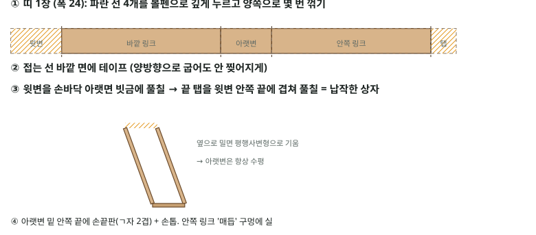

### 3-2. 손바닥에 붙이기

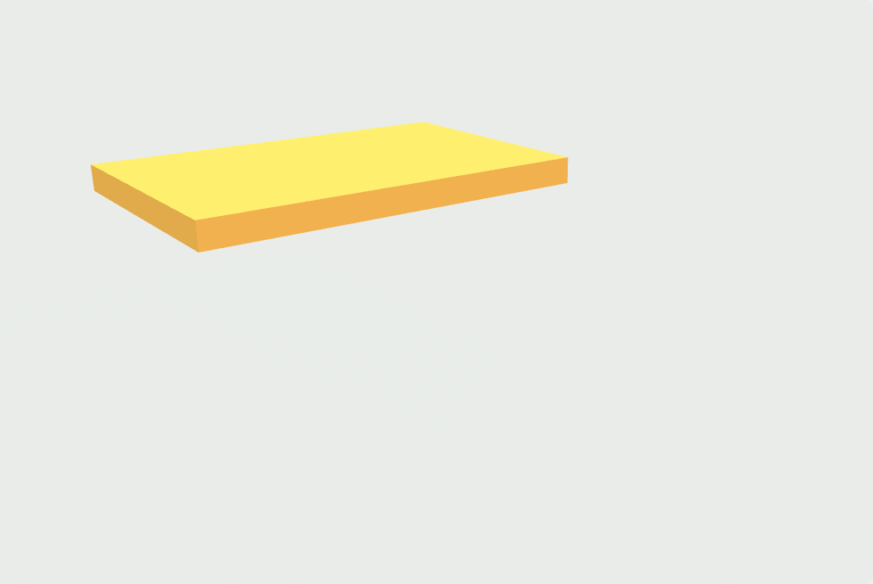

1. **윗변**을 손바닥 아랫면 **빗금 자리**에 풀칠해요(아랫면 지도 참고).
   - 앞 손가락: x=−12…+12, y=+12…+36
   - 뒤 손가락: y=−36…−12
   - **안쪽 링크**(매듭 구멍 있는 쪽)가 손바닥 **가운데 쪽**을 향해야 해요.


### 3-3. 손끝판 · 손톱

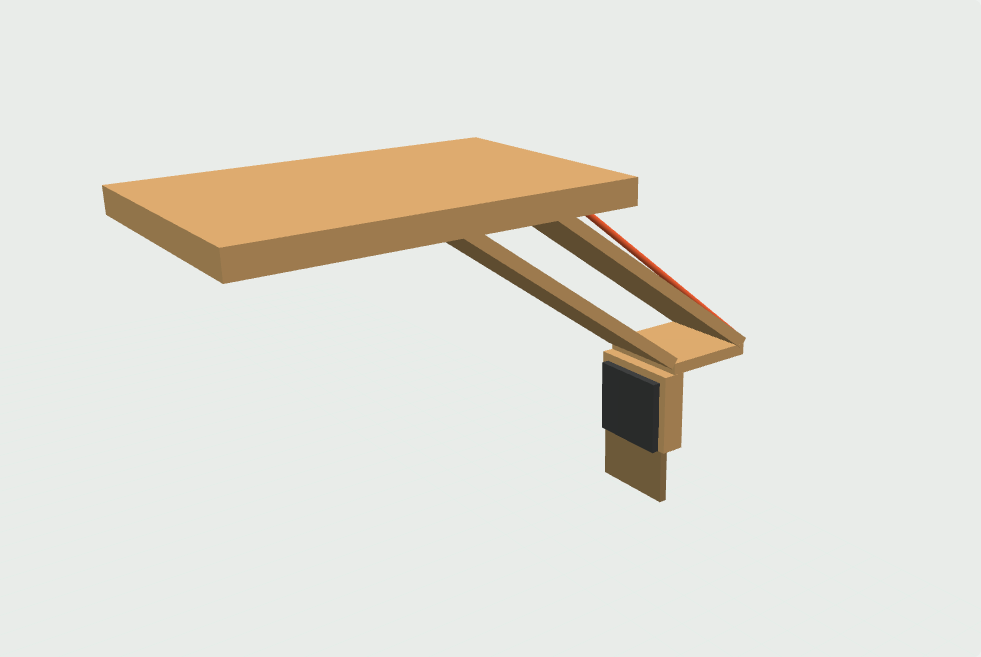

1. **#4 손끝판(ㄱ자)** 2장을 겹쳐 붙이고 접는 선에서 90° 꺾어요. **12 mm 쪽**을 아랫변 아랫면의 **안쪽 끝**에 풀칠하면 손끝판이 수직으로 내려와요.
2. **#8 삼각 보강**을 ㄱ자 안쪽 모서리에 붙여요.
3. **#5 손톱** 3장:
   - **1장만** 위 6 mm 탭을 남기고, 2장은 탭을 잘라 아래 14 mm만 겹쳐 붙여요.
   - 탭을 손끝판 **바깥면** 아래쪽에 붙이고, 접는 선을 손끝판 아래 모서리에 맞춰 테이프로 감싸요.
4. **#6 손톱 스토퍼**를 손끝판 **안쪽 면(물체 쪽)** 아래에 붙여요. 모서리보다 2 mm 아래로 나오게 해서 손톱이 안쪽으로 못 접히게 해요.
   - 결과: 쥘 때는 단단하고, 바닥에 눌리면 **바깥·위로 접혀요**(최대 약 11.6 mm 순응).
5. 손톱 안쪽 면에 고무줄 2바퀴를 감아 미끄럼을 막아요.

## 4단계: 실과 고무줄 (교차 실)

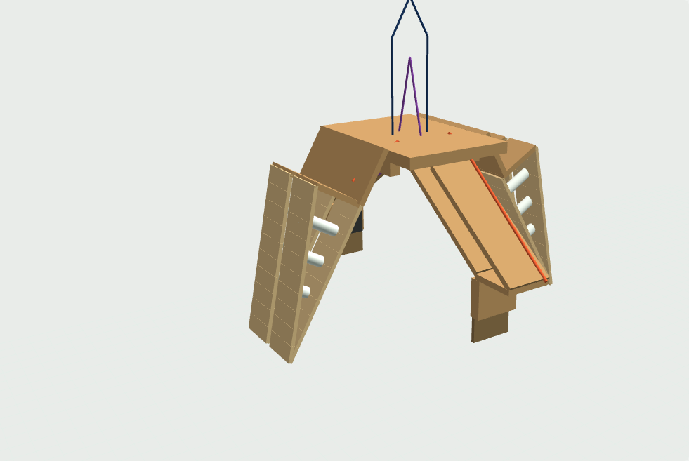

**날개 실 (soft, 한 가닥)**

```
            손잡이 (위로 당김)
               ╱ ╲
   손바닥 ═════○═══○═════   ← 빨대 슬리브 구멍 x=−10, x=+10
 날개 ●╲________╳________╱● 날개
    매듭   (손바닥 밑에서 X자로 교차)   매듭
```

1. **오른쪽 날개 매듭 구멍**에 묶어요(매듭은 날개 바깥면 쪽).
2. 실을 손바닥 밑으로 보내 **왼쪽 구멍(x=−10)** 으로 올려요.
3. 손잡이에 건 뒤 **오른쪽 구멍(x=+10)** 으로 내려요.
4. 손바닥 밑으로 보내 **왼쪽 날개 매듭 구멍**에 묶어요.

두 실은 구멍이 1.5 mm씩 엇갈려 있어서 교차할 때 서로 닿지 않아요.

**손가락 실 (hard, 한 가닥)**

```
  손바닥 ════○══════════○════      ← 빨대 슬리브 구멍 y=+8 (앞쪽), y=−8 (뒤쪽)
   뒤 상자   ╲        ╱   앞 상자
       매듭 ● ╲    ╱ ● 매듭       (안쪽 링크, 윗 접는 선에서 70)
                ╲╱  ← 손바닥 밑에서 교차
```

1. **앞 손가락 안쪽 링크의 매듭 구멍**에 묶어요.
2. 손바닥 밑으로 **뒤쪽 구멍(y=−8)** 으로 올려요.
3. 손잡이에 건 뒤 **앞쪽 구멍(y=+8)** 으로 내려요.
4. **뒤 손가락 매듭 구멍**에 묶어요.

**고무줄과 제한 실**

| 줄 | 경로 | 비고 |
|---|---|---|
| soft 복원 고무줄 ×2 | 손바닥 고무줄 구멍 ↔ 날개 바깥면 (테이프) | 약하게 |
| hard 복원 고무줄 ×2 | 아랫변 바깥 끝 ↔ 손바닥 아랫면 바깥쪽 (테이프) | 약하게 |
| 열림 제한 실 | 날개 ↔ 손바닥 (30°에서 팽팽), 아랫변 ↔ 손바닥 (54°에서 팽팽) | 짧게 |

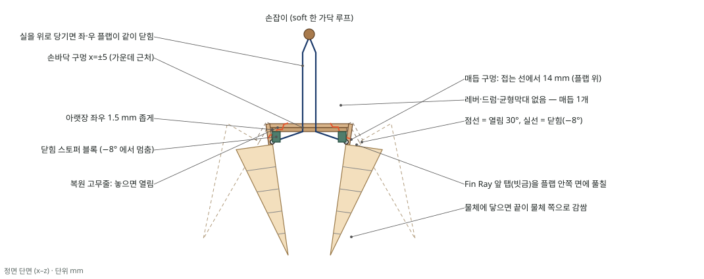

- 매듭에 풀을 한 방울 떨어뜨려 풀림을 막아요.
- **매끄러운 실**을 써요. 손잡이 힘은 그리퍼 쪽만 약 13 N(hard)·17 N(soft)이고, 팔을 지나는 마찰이 더해져요.
- **복원 고무줄은 약하게** 해요. 실을 놓으면 열릴 정도면 충분해요.

## 5단계: 확인

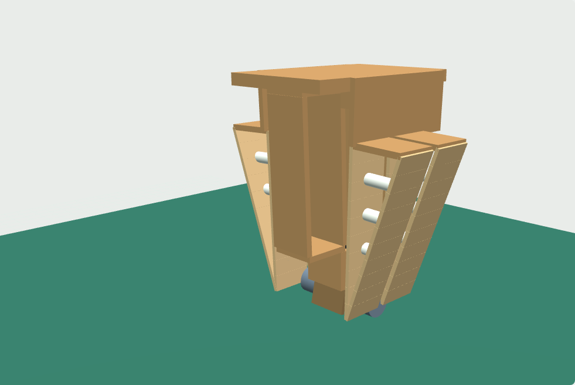

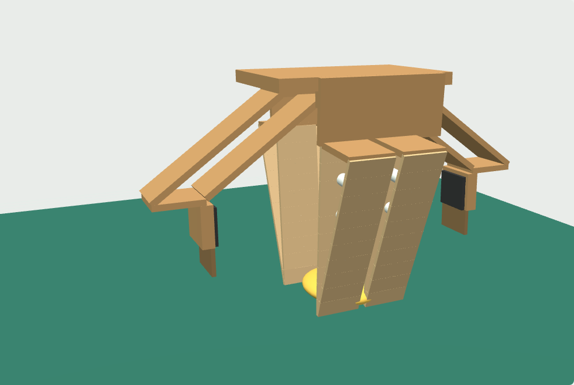

- [ ] hard 실을 당기면 앞·뒤 손가락이 **같이** 닫히고 손끝판이 **수직**을 유지해요.
- [ ] 놓으면 약 54°까지 열려요.
- [ ] soft 실을 당기면 좌·우 날개가 같이 닫히고 Fin Ray가 감싸요. 놓으면 약 30°까지 열려요.
- [ ] 교차하는 실끼리 비비지 않아요. 비비면 슬리브 위치를 조금 옮겨요.
- [ ] 손톱이 바닥에 눌리면 접히고, 떼면 돌아와요.
- [ ] 건전지를 쥐고 들어도 안 떨어져요.
- [ ] 팔에 달 때는 손바닥 **윗면 가운데 24×30** 안에만 접착해요. 실 구멍 4개가 모두 이 안에 있어서 팔 손목으로 바로 올라가요.

## 참고: 계산 값 (SymPy)

| 항목 | 값 |
|---|---|
| 건전지 집을 때 손바닥 높이 | 115.4 mm (날개를 30 mm로 늘려 B5보다 14 mm 높음) |
| hard 열림 / 개구 | 54° / 135 mm |
| hard 실 모멘트 팔 (쥐는 구간) | 17.6–19.1 mm (교차 전 10.8–11.7) |
| hard 실 장력 (집는 힘 1.5 N) | 6.1 N |
| soft 실 모멘트 팔 | 17.6–24.2 mm (교차 전 10.6–13.7) |
| soft 실 장력 (손가락당 0.5 N) | 6.5 N |
| 구멍에서 꺾이는 각 (hard / soft) | 15° / 63° — soft 쪽은 빨대 슬리브가 특히 중요 |
| 손톱 순응 | 11.6 mm |
